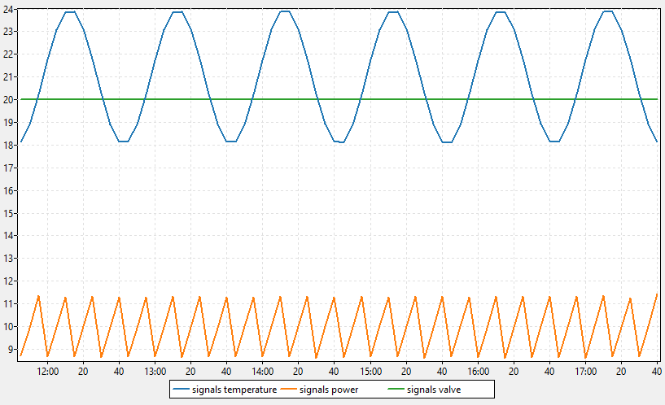

# InfluxDB Client (Lazarus)

A desktop client for InfluxDB, written in Free Pascal / Lazarus with normal forms and TAChart. No DLL. It works with:
- InfluxDB 1.x;
- [InfluxServer](../InfluxServer/README.md) of this project;
- InfluxDB 2.x through its v1 compatibility API.



## Build and run

```bash
C:\lazarus\lazbuild.exe InfluxClient\InfluxClient.lpi
```

Enter the **URL** (default `http://127.0.0.1:8086`), and the user and password if the server needs them, then press **Connect**. The status shows the server version and the answer time.

| Part | |
|---|---|
| **Tree** (left) | databases → measurements → `fields` (with their type) / `tags` → tag values. A node is loaded when it is opened (`SHOW MEASUREMENTS / FIELD KEYS / TAG KEYS / TAG VALUES`). |
| **Double-click** | measurement: its last 100 points of the last hour.<br>Numeric field: `mean()` per minute of the last hour, shown on the chart.<br>Tag value: the points with that tag.<br>The query goes into the editor and runs at once. |
| **Query** | InfluxQL editor, `Ctrl+Enter` / `F9`, database box. Several statements with `;` are allowed. **History** keeps the last 20 queries. `SELECT` / `SHOW` are sent with GET; `CREATE`, `DROP`, `DELETE` with POST, as InfluxDB 1.x wants. |
| **Table** | every series of every statement under each other. The first column is the measurement and its tags. Time is local (or *Times in UTC*), with ms. At most 50,000 rows are shown. |
| **Chart** | a line for every numeric or boolean column of every series, up to 40 lines, with a time axis. Drag = zoom, right drag = pan, mouse wheel = zoom. |
| **JSON** | the raw answer of the server. |
| **Write** | line protocol (one point per line) with a precision (`ns u ms s`), sent to the selected database. |

Settings and history are saved in `InfluxClient.ini`. **The password is not saved.**

**Command line:**
- `--query=<InfluxQL> --db=<db>` runs a query at start.
- Adding `--snapshot=<file.png>` also saves the chart, plus a `.txt` with the table and the whole opened tree, then closes. It is used for tests without a screen.

## Files

```
InfluxClient.lpi / .lpr      project (LCL + TAChartLazarusPkg)
uinfluxclientmain.pas / .lfm main window, tree, query, table, chart (made in code), write
uinfluxapi.pas               InfluxDB HTTP calls: ping, query (GET / POST), write, quoting, JSON helpers
                             (also used by ../InfluxSignalGen)
```
