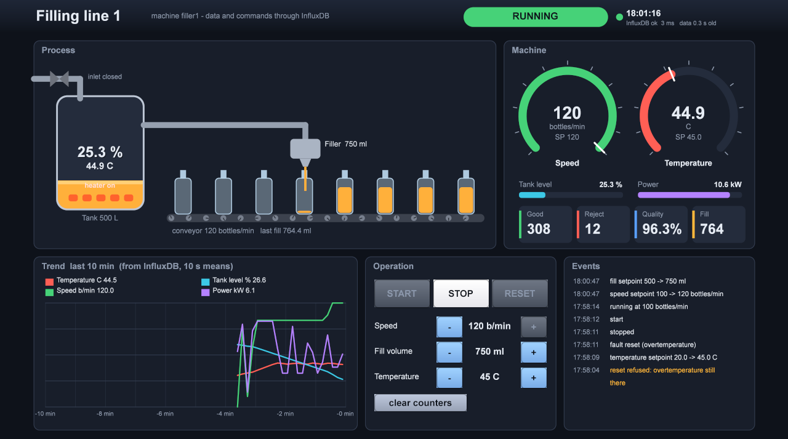

# Example: machine + HMI through InfluxDB (BGRABitmap, Lazarus)

A bottle filling machine and its operator screen. **InfluxDB is the only link between them.** The machine writes its data into InfluxDB, and the HMI reads it from there and writes its commands back into InfluxDB, where the machine picks them up. Both programs are Free Pascal / Lazarus, and neither needs a DLL. The HMI is drawn with BGRABitmap.



| Program | |
|---|---|
| `MachineSim.lpi` | the machine (simulation); a small window with values and log |
| `MachineHMI.lpi` | the operator screen (BGRABitmap, needs BGRABitmapPack) |
| InfluxDB | [InfluxServer](../InfluxServer/README.md) of this project, or a real InfluxDB 1.x |

## Run

```bash
C:\lazarus\lazbuild.exe InfluxMachine\MachineSim.lpi
C:\lazarus\lazbuild.exe InfluxMachine\MachineHMI.lpi
```

1. Start InfluxServer (or InfluxDB) on `http://127.0.0.1:8086`.
2. Start `MachineSim.exe` and press **Run machine**. It creates the database `machine` itself if the server answers "database not found".
3. Start `MachineHMI.exe` and press **Connect**, then press **START**.

The URL and database are saved in `MachineSim.ini` / `MachineHMI.ini`. The HMI can also run on another PC: only the URL changes.

## The machine (`umachinesim.pas`)

| Part | Behaviour |
|---|---|
| State | `STOPPED` → start → `STARTING` (ramp 40 bottles/min per s) → `RUNNING` → stop → `STOPPING` → `STOPPED` |
| Faults | **tank empty** (< 5 %) or **overtemperature** (> setpoint + 15 C): the conveyor stops and the state is `FAULT`. **RESET** works only once the cause is gone (level ≥ 15 %, temperature ≤ setpoint + 10) |
| Bottles | at the conveyor speed (0…120 / min). Each bottle gets *fill setpoint* ± 0.8 %. A product colder than setpoint − 5 C fills less exactly. Off by more than 2 % = **reject** |
| Tank | 500 L, emptied by the filling. The inlet valve opens below 25 % and closes above 85 % (2 L/s) |
| Heater | thermostat ± 0.5 C around the setpoint, heat loss to 20 C |
| Power | drive + heater (6 kW) + inlet pump |

## InfluxDB layout (`umachinedef.pas`)

```
machine  every 500 ms
  machine,machine=filler1 state="RUNNING",running=true,speed_sp=100,speed=99.6,fill_sp=500,
    fill_last=501.2,tank_level=63.4,inlet=false,temp=45.1,temp_sp=45,heater=true,power=9.85,
    good=1234i,reject=12i,fault="" <ms>
events   on every change, with the level info | warn | alarm
  events,machine=filler1,level=alarm text="FAULT: overtemperature (39.7 C)" <ms>
command  written by the HMI (or anybody)
  command,machine=filler1,source=hmi cmd="start" <ms>            start | stop | reset | clear
  command,machine=filler1,source=hmi speed_sp=100 <ms>           also fill_sp, temp_sp
```

- **Commands:** the machine reads every 500 ms the commands that are newer than the last one it saw (`SELECT * FROM command WHERE time > …ms`). Older commands from before its start are ignored. The machine checks and limits the setpoints itself (speed 0…120, fill 250…1000 ml, temperature 20…80 C).
- **The HMI reads** (in its own thread, so the 30 fps picture never waits):
  - `SELECT last(*)`, plus the time of the last point, every 500 ms;
  - the trend `mean(...) GROUP BY time(10s)` of the last 10 min, every 5 s;
  - the last events every 2 s.

  Commands are sent at once.
- **Any tool works:** a command can also come from the [InfluxClient](../InfluxClient/README.md) Write tab, curl or Python, and every value can go to Grafana:

```bash
curl -XPOST "http://127.0.0.1:8086/write?db=machine&precision=ms" --data-binary "command,machine=filler1,source=curl cmd=\"start\""
```

## The HMI (`uhmimain.pas`)

| Area | |
|---|---|
| Header | state (RUNNING green, STARTING / STOPPING amber, **FAULT blinking red** with the cause, **NO DATA** when the last point is older than 3 s), clock, InfluxDB answer time and age of the data |
| Process | tank with eased liquid level and temperature, heater coil (glows when on), inlet valve with drops when open, pipe, filler with a stream while running. The conveyor rollers turn and the bottles move at the reported speed; they are empty before the nozzle and filled after it |
| Machine | gauges for speed and temperature with a setpoint marker; bars for tank level and power; tiles for good, reject, quality %, last fill |
| Trend | temperature, tank level, speed and power of the last 10 min, each on its own scale, with the last value in the legend |
| Operation | **START / STOP / RESET**, enabled only when they make sense (START when stopped, RESET only in FAULT); setpoints **− / +** for speed (10), fill (50 ml) and temperature (1 C). A setpoint shows `...` until the machine reports it; *clear counters* |
| Events | the last events with the time; warnings amber, alarms red |

**Drawing:** everything is drawn with BGRABitmap (anti-aliased shapes, gradients, text), including the buttons with hover and press feedback. The screen is designed at 1280 × 760 and scales to any window size.

**Command line:**
- `--connect` connects at start;
- `--cmd=start|stop|reset|clear` and `--speed=<bottles/min>` send a command at start;
- `--snapshot=<file.png> --after=<s>` saves one frame and closes (used for the screenshot and the tests). `MachineSim` has `--start`.

## Test that was run

Everything ran through InfluxServer with *Create databases on write* **off**:

| Step | Result |
|---|---|
| MachineSim on | creates the database, `STOPPED`, a point every 500 ms (60 points in 30 s) |
| `MachineHMI --cmd=start --speed=100` | the machine gets both commands from InfluxDB: events `start`, `speed setpoint 80 -> 100`, `running at 100 bottles/min`; the HMI frame shows RUNNING, moving bottles, gauges, tiles |
| command `temp_sp=20` while the product is ~40 C | `FAULT: overtemperature`, the conveyor stops; HMI: blinking FAULT, only RESET enabled, alarm in red |
| RESET at once | `reset refused: overtemperature still there` (warning) |
| `temp_sp=45`, RESET, START | `fault reset`, `stopped`, `start`, `running` |
| speed 120, fill 750 ml | the speed gauge at the maximum, the + button disabled, tank level falling to 25 %, the inlet valve opens, quality 96 % once the product is warm |

## Files

```
MachineSim.lpi / .lpr       machine project
usimmain.pas / .lfm         machine window (values, log, local start / stop / reset)
umachinesim.pas             the process (TFillingMachine) and its InfluxDB thread (TMachineRunner)
MachineHMI.lpi / .lpr       HMI project (requires BGRABitmapPack)
uhmimain.pas / .lfm         the HMI screen, drawn with BGRABitmap
uhmidata.pas                HMI thread: live / trend / events queries, command queue
umachinedef.pas             shared: InfluxDB layout, limits, line protocol and JSON helpers
../InfluxClient/uinfluxapi.pas   InfluxDB HTTP calls
```
