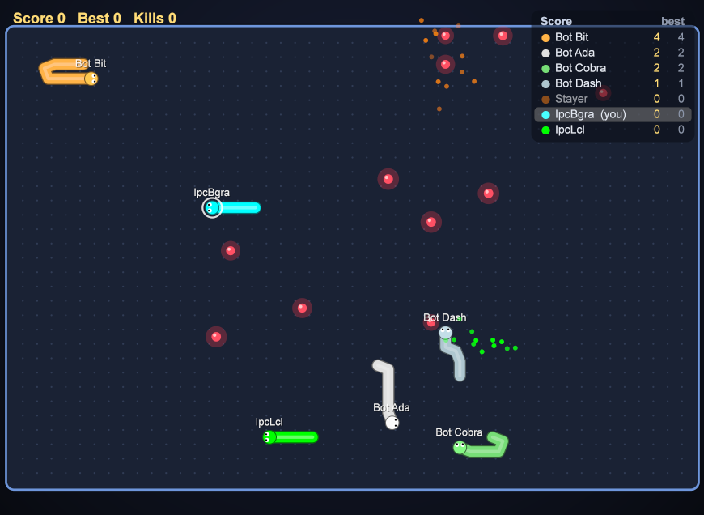

# Snake Arena IPC: game server and clients over IPC (Lazarus)

The multiplayer Snake game of [MqttGame](../MqttGame/README.md), but without a network: the server and the players talk through **IPC on one PC**. There is no broker, no port and no firewall. It has the same rules, bots, scores and drawing as the MQTT version.



| Project | What |
|---|---|
| `IpcGameServer.lpi` | the game server: the server window of MqttGame, built with `-dIPC` |
| `IpcSnakeLCL.lpi` | client drawn with the LCL Canvas: `../SnakeLCL/usnakelcl.pas` built with `-dIPC` |
| `IpcSnakeBGRA.lpi` | client drawn with BGRABitmap: `../SnakeBGRA/usnakebgra.pas` built with `-dIPC` (needs BGRABitmapPack) |

The forms aren't copied. The same sources are compiled with the switch `-dIPC` (*Project Options → Custom options*), in the same way the HMI Set 2 projects use `-dLINEAR2`. Only the transport unit changes:
- the server uses `uipchost` instead of the broker + `ugamehost`;
- the clients use `ipcsnakeclient` instead of `snakeclient`.

Both pairs have the same class names and methods.

## Build and run

```bash
C:\lazarus\lazbuild.exe IpcGame\IpcGameServer.lpi
C:\lazarus\lazbuild.exe IpcGame\IpcSnakeLCL.lpi
C:\lazarus\lazbuild.exe IpcGame\IpcSnakeBGRA.lpi
```

1. Start `IpcGameServer.exe` and press **Start**.
2. Start any number of clients, enter a name and colour, and press **Connect**. The IPC windows have no Host / Port fields.
3. Steer with the arrows or W A S D.

You can start the clients first: they show *Waiting for the IPC game server ...* and join as soon as it runs.

The command line works as in the MQTT clients: `--connect`, `--snapshot=<file.png> --after=<s>`.

## How the IPC works

Two IPC channels, one for each direction:

| Direction | Channel | Why |
|---|---|---|
| client → server: commands | **SimpleIPC** (`simpleipc`, FPC fcl-process), server id `SnakeArenaIPC` | many senders, one receiver; a command reaches the game within a few ms |
| server → clients: game state | **shared memory** `Local\SnakeArenaIPC_State` (1 MB, `CreateFileMapping`) | written **once** per tick for all clients, no copy per client; a slow client never holds up the server |

- **Commands:** `<client id> <pid> <command>`, with the same commands as the MQTT version: `join <RRGGBB> <name>`, `dir U|R|D|L`, `ping` (every 2 s), `leave`.
- **State:** the same text as `snake/state` in MQTT (`S` / `F` / `P` / `B` lines, see `../MqttGame/snakeproto.pas`), plus the last 20 events as `E <id> <text>` lines. A client shows each event only once, by its id.
- **No locks on the state (seqlock):** the server makes the sequence counter odd, writes, then makes it even. A client copies the text and keeps it only if the counter was even and didn't change while it copied, otherwise it reads again. The server never waits for a client.
- **The server's message loop is its timer:** the game thread owns the SimpleIPC window and waits with `PeekMessage(timeout)` until the next tick. A command is handled within a few ms, and the tick stays on time (measured: 99.9 ms mean for 100 ms).

## When a program ends

| What happens | Result |
|---|---|
| a client closes | it sends `leave`, and its snake is gone at once |
| a client crashes or is killed | the server holds a handle of each client process (pid from the commands) and removes the snake in the next tick, like the last will of MQTT |
| a client hangs | removed after 10 s without a command |
| the server stops (Stop / close) | it clears the server pid in the block, and the clients see it at once and wait for a new server |
| the server is killed | the clients check every 0.5 s whether the server process still runs |
| the server is started again | the clients notice the new server pid, connect again and join again by themselves, even though the new server reuses the block they still hold open |
| a second server is started | refused: "another Snake Arena IPC server is already running on this PC" |

**Note for test tools:** don't create `Local\SnakeArenaIPC_State` yourself before the server runs. For example, Python's `mmap(-1, size, tagname=...)` *creates* the block when it is missing, read-only in that case, and the server then can't map it. The server reports this ("created by another program"). The clients never create the block; they only open it.

## Files

```
IpcGameServer.lpi / .lpr   server project (-dIPC, form = ../MqttGame/ugameserver)
IpcSnakeLCL.lpi / .lpr     LCL client project (-dIPC, form = ../SnakeLCL/usnakelcl)
IpcSnakeBGRA.lpi / .lpr    BGRABitmap client project (-dIPC, form = ../SnakeBGRA/usnakebgra)
uipchost.pas               game thread with the SimpleIPC server, commands, state writing, client process watch
ipcsnakeclient.pas         client side: SimpleIPC commands, state reading, reconnect
ipcshared.pas              shared memory block (seqlock writer / reader), ids, ProcessAlive
../MqttGame/snakegame.pas, snakeproto.pas   rules and state text (shared with the MQTT version)
```
