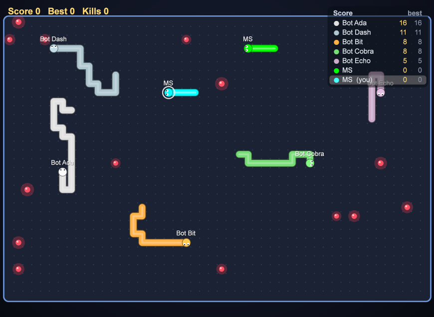

# Snake Arena (BGRABitmap)

A game client for the [Snake Arena MQTT game server](../MqttGame/README.md), drawn with **BGRABitmap**. It plays exactly like the [LCL client](../SnakeLCL/README.md): the game logic and MQTT side are the same unit (`../MqttGame/snakeclient.pas`). Only the drawing is different.



## Build and run

Needs the **BGRABitmapPack** package (Online Package Manager), the same as HMI2.

```bash
C:\lazarus\lazbuild.exe SnakeBGRA\SnakeBGRA.lpi
```

1. Start the game server.
2. Enter **Host** / **Port** (`127.0.0.1:1886`), your **Name** and a colour.
3. Press **Connect**.
4. Steer with the arrows or W A S D. Enter = respawn now.

## Drawing

- **Smooth movement:** the server moves the snakes 10 times per second. This client draws 60 frames per second, and places every body cell between its position in the previous state and the last one. The snakes glide instead of jumping. When a snake wraps around the arena edge or respawns, it is not slid across the arena.
- **Snakes:** anti-aliased round polylines with an outline and a shine, a head with eyes looking where it goes, and name tags above everything. Your snake has a white ring.
- **Food:** a red core with a highlight and a pulsing glow.
- **Death:** the snake bursts into particles of its colour that fly apart and fade out.
- **Overlay:** a translucent scoreboard (top 10), your score, and a "Respawning" panel.
- **Background:** the gradient, rounded arena, grid dots and walls are drawn into a cached bitmap once per size. Each frame copies it and draws only the moving parts.
- The status line shows the frames per second.

## IPC build

`../IpcGame/IpcSnakeBGRA.lpi` compiles this same window with `-dIPC`. It then plays on the [IPC game server](../IpcGame/README.md) of this PC (no Host / Port).

## Command line

| Option | |
|---|---|
| `--connect` | connect at start with the saved settings |
| `--snapshot=<file.png> --after=<s>` | connect, save one frame as PNG after s seconds (default 5), then exit |

Settings are saved in `SnakeBGRA.ini`.

## Files

```
SnakeBGRA.lpi / .lpr         project (requires BGRABitmapPack)
usnakebgra.pas / .lfm        window and BGRABitmap drawing
../MqttGame/snakeclient.pas  join / turn / ping / will, game states
../MqttGame/snakeproto.pas   the protocol
../MqttClient/umqttclient.pas, ../MqttSim/mqttcodec.pas   MQTT client
```
