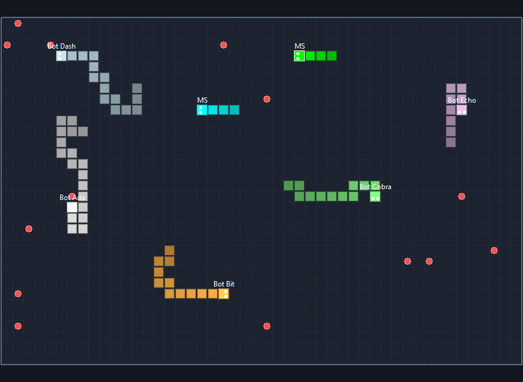

# Snake Arena (LCL)

A game client for the [Snake Arena MQTT game server](../MqttGame/README.md), drawn with the standard **LCL Canvas** (double-buffered `TBitmap`, no extra packages). The game logic and the MQTT side are in `../MqttGame/snakeclient.pas`, shared with the [BGRABitmap client](../SnakeBGRA/README.md).



## Build and run

```bash
C:\lazarus\lazbuild.exe SnakeLCL\SnakeLCL.lpi
```

1. Start the game server.
2. Enter **Host** / **Port** (`127.0.0.1:1886`), your **Name** and a colour.
3. Press **Connect**.

| Key | |
|---|---|
| Arrows or W A S D | steer |
| Enter | respawn now / join again with a new name or colour |

Click into the arena if the keys go into an edit box.

- **Arena:** grid, walls (unless the server wraps around), food, snakes with eyes and name tags. Your head has a white outline.
- **Right side:** your score, best and kills; the scoreboard (`>` = you, `...` = respawning); a short help text; the server events.
- **Connection:** reconnects on its own. A crashed client is removed from the game by its last will.
- **Settings:** saved in `SnakeLCL.ini`.

## IPC build

`../IpcGame/IpcSnakeLCL.lpi` compiles this same window with `-dIPC`. It then plays on the [IPC game server](../IpcGame/README.md) of this PC (no Host / Port).

## Command line

| Option | |
|---|---|
| `--connect` | connect at start with the saved settings |
| `--snapshot=<file.png> --after=<s>` | connect, save one frame as PNG after s seconds (default 5), then exit. Used for the screenshot above and for testing without a screen |

## Files

```
SnakeLCL.lpi / .lpr          project
usnakelcl.pas / .lfm         window and drawing
../MqttGame/snakeclient.pas  join / turn / ping / will, game states
../MqttGame/snakeproto.pas   the protocol
../MqttClient/umqttclient.pas, ../MqttSim/mqttcodec.pas   MQTT client
```
